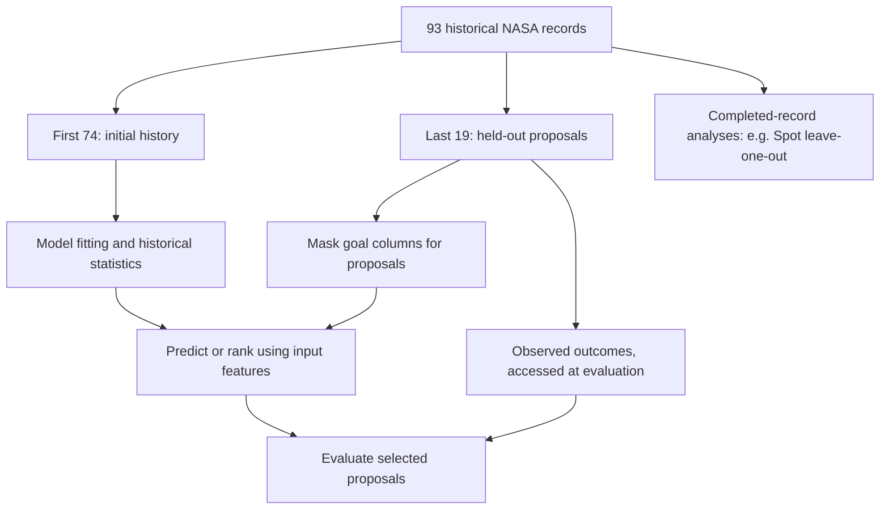
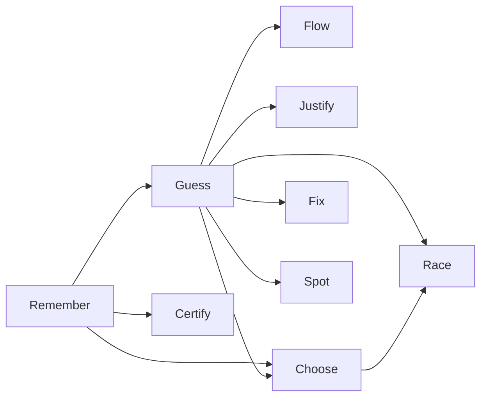

# NASA Software Project Estimation — Experiment and Reproducibility

**Project:** The Shrinking-Code Experiment  
**Course:** CSC 591 — AI & Software Engineering  
**Dataset:** `data/raw/nasa93dem.csv`  
**Implementation directory:** `human_t7/nasa/`  
**Development branch:** `human-t7-nasa`  
**Frozen requirements:** [`docs/requirements_nasa.md`](../../docs/requirements_nasa.md), version 1.0 (November 6, 2026)  
**Final implementation checkpoint:** `t7-nasa-step10` (`ddb3e0b`)  
**Results and interpretation:** [`RESULTS.md`](RESULTS.md)

> **Scope.** This document records the implementation setup, algorithms, requirement mapping, experiment controls, Git checkpoints, line-counting procedure, and verification commands. Numerical findings and charts are maintained in `RESULTS.md` rather than duplicated here.

## 1. Research objective and scope

The NASA domain uses 20 frozen customer requirements, grouped into ten sequential skills. Each skill introduces a new capability while allowing previously implemented modules to be reused. The experiment records the amount of newly introduced implementation code at successive checkpoints and evaluates selected capabilities against simple baselines.

The implementation provides a research prototype, not a production project-management service. Its output is exploratory and depends on the recorded sample, feature representation, and evaluation setup.

### Requirement-to-module mapping

| Step | Skill | Frozen requirements | Implementation file | Primary responsibility |
|---:|---|---|---|---|
| 1 | Remember | NASA-01, NASA-02 | `remember.py` | Load and summarize historical records; rank outcomes |
| 2 | Guess | NASA-03, NASA-04 | `guess.py` | Neighbor-based effort and defect estimates |
| 3 | Certify | NASA-05, NASA-06 | `certify.py` | Statistical comparison of selected rating groups |
| 4 | Flow | NASA-07, NASA-08 | `flow.py` | Sequential proposal assessment and history updates |
| 5 | Blame | NASA-09, NASA-10 | `blame.py` | Identify attributes associated with outcome extremes |
| 6 | Justify | NASA-11, NASA-12 | `justify.py` | Neighbor explanations and proposal comparisons |
| 7 | Choose | NASA-13, NASA-14 | `choose.py` | Historical examples and budget-limited inspections |
| 8 | Fix | NASA-15, NASA-16 | `fix.py` | Search hypothetical adjustments to selected settings |
| 9 | Spot | NASA-17, NASA-18 | `spot.py` | Input-distance and outcome-residual anomaly detection |
| 10 | Race | NASA-19, NASA-20 | `race.py` | Prediction and project-selection baseline comparisons |

The authoritative wording and acceptance intent remain in the frozen requirements file; the descriptions above are implementation summaries, not replacements for that specification.

## 2. Data and experimental partitions

- **Source:** `data/raw/nasa93dem.csv`, resolved relative to the repository root by `remember.py`.
- **Records:** 93 software projects; dataset row numbers in program output are 1-based and refer to the original data order.
- **Inputs:** 22 categorical project characteristics used by the neighbor-based methods. Columns ending in `X` are ignored by feature selection; goals and the generated row identifier are not predictors.
- **Goals:** `Kloc+` (maximize), `Effort-` (minimize), and `Defects-` (minimize), following the frozen dataset's header convention.
- **Training/history partition:** first 74 records.
- **Held-out partition:** final 19 records (rows 75–93).

For the proposal-evaluation methods, held-out goals are withheld during ranking and prediction, then revealed only when an evaluation requires observed outcomes. This is a *fixed ordered split*, not randomized cross-validation. Some descriptive historical analyses, such as the final Spot analysis, operate across all 93 completed records rather than claiming an unseen evaluation sample.

### Data-flow boundaries



## 3. Implementation conventions and method choices

The modules use standard Python and import shared functions from the preceding skill files. Execute them from the repository root with the commands in Section 6. No external machine-learning package is required by the ten demonstrated module implementations.

### Shared computations

**Categorical distance.** For two projects `a` and `b`, the feature distance is the proportion of selected input columns where their recorded categorical values differ:

\[
 d_X(a,b)=\frac{1}{|X|}\sum_{j\in X}\mathbf{1}[a_j\ne b_j].
\]

**Nearest-neighbor prediction.** Use the five closest historical projects, sorted deterministically by distance and then row number. The predicted outcome is their arithmetic mean. The minimum and maximum neighbor outcomes are descriptive bounds, **not calibrated confidence or prediction intervals**.

**Distance to heaven (d2h).** Normalize the three goals with historical minimum and maximum values, then compute root mean squared distance from their ideal normalized values (1 for `Kloc+`, 0 for `Effort-` and `Defects-`). Lower scores are preferred. The relevant normalization population matters: historical training bounds are used for held-out selection evaluation, while full-dataset descriptive rankings may use all 93 records.

### Skill-specific decisions

| Skill | Main implementation choice | Important scope note |
|---|---|---|
| Remember | CSV parsing, summary statistics and d2h ranking | Ranking reflects the three specified goal directions |
| Guess | k=5, normalized categorical mismatch, neighbor-mean prediction | All X attributes receive equal weight |
| Certify | Two-sided 9,999-permutation test of difference in means | This is not the course's separate `same` method; non-significance does not prove equivalence |
| Flow | Predict each arrival, compare with history's 75th-percentile alert thresholds, then append its observed record | The sequential simulation is not an external streaming system |
| Blame | Compare bottom/top 23 records per goal using categorical total-variation distance | A high separation score is an association, not a cause |
| Justify | Show five supporting neighbors and compare two proposals' predicted risks and differing X fields | Explanations describe model evidence, not causal contributions |
| Choose | Rank held-out proposals once using X-only predictions of all three goals; inspect budgets 3, 5, 10 | This is fixed-order selection, not adaptive search |
| Fix | Explore observed values of `docu`, `tool`, `site`, `sced`, changing one or two settings | Require at least 5% improvement; for defect repair cap predicted effort increase at 5%; hypothetical only |
| Spot | Average distance to five other records; leave-one-out absolute residuals | Projects under inspection are excluded from their own neighbor sets |
| Race | Compare kNN MAE to historical mean; compare fixed ranking against 30 seeded random orders | The random-order comparison is descriptive rather than a significance test |

The Fix candidate generator only tries values observed for individual attributes in training. It does not guarantee every proposed combination is common or feasible in practice.

## 4. Git checkpoint history

Each checkpoint corresponds to a sequential skill implementation. The final tag is the reference point for the complete ten-module code state.

| Step | Git tag | Commit | Skill |
|---:|---|---|---|
| 1 | `t7-nasa-step1` | `2fd2e53` | Remember |
| 2 | `t7-nasa-step2` | `4ab4582` | Guess |
| 3 | `t7-nasa-step3` | `e37e5b1` | Certify |
| 4 | `t7-nasa-step4` | `973b9f2` | Flow |
| 5 | `t7-nasa-step5` | `43ba989` | Blame |
| 6 | `t7-nasa-step6` | `d5ecf52` | Justify |
| 7 | `t7-nasa-step7` | `a6a23af` | Choose |
| 8 | `t7-nasa-step8` | `3d7ba92` | Fix |
| 9 | `t7-nasa-step9` | `fb56aee` | Spot |
| 10 | `t7-nasa-step10` | `ddb3e0b` | Race |

These hashes and tags were checked against the terminal Git history shared during the implementation. A documentation commit after Step 10 will not alter the tagged source states.

Verify locally:

```bash
git switch human-t7-nasa
git tag --list 't7-nasa-step*' | sort -V
git log --oneline --decorate -12
git status --short
```

The module import structure illustrates reuse across skills:



The diagram emphasizes selected reusable dependencies, not an exhaustive import graph.

## 5. Lines-of-code measurement

### Reported counting convention

The recorded measure is **nonblank, non-comment Python source lines** in the module newly introduced at each skill's checkpoint. It includes executable statements, imports, function definitions and non-comment textual lines such as docstrings. It excludes blank lines and standalone comments. The counting script used Python's `tokenize` module and treated any line carrying a `COMMENT` token as excluded; therefore a rare code line with an inline comment would also be excluded under this *exact script*, even though its code portion is executable.

This is **new-module LOC**, not the size of the full accumulated repository or a Git diff of all additions and deletions. Changes to an older module after its checkpoint, if any, would need separate accounting for a true per-step repository-wide net-growth metric. Documentation, CSV data and tests outside the measured module are not counted.

### Reproduce the measured counts

Run the following from the repository root. It reads each file directly from its immutable skill tag and does not depend on the working-tree copy:

```bash
python3 - <<'PY'
import subprocess
import tokenize
from io import BytesIO

files = (
    'remember.py', 'guess.py', 'certify.py', 'flow.py',
    'blame.py', 'justify.py', 'choose.py', 'fix.py',
    'spot.py', 'race.py',
)

def git_bytes(*arguments):
    return subprocess.check_output(['git', *arguments])

total = 0
print(f"{'Step':<6} {'Skill':<12} {'New LOC':>8}")
print('-' * 30)
for step, filename in enumerate(files, 1):
    source = git_bytes(
        'show',
        f't7-nasa-step{step}:human_t7/nasa/{filename}',
    )
    comment_lines = {
        token.start[0]
        for token in tokenize.tokenize(BytesIO(source).readline)
        if token.type == tokenize.COMMENT
    }
    lines = source.decode('utf-8').splitlines()
    loc = sum(
        bool(line.strip()) and number not in comment_lines
        for number, line in enumerate(lines, 1)
    )
    total += loc
    print(f'{step:<6} {filename[:-3].capitalize():<12} {loc:>8}')
print('-' * 30)
print(f"{'TOTAL':<19} {total:>8}")
PY
```

### Recorded LOC sequence

| Step | Skill | New LOC | Cumulative new-module LOC |
|---:|---|---:|---:|
| 1 | Remember | 124 | 124 |
| 2 | Guess | 103 | 227 |
| 3 | Certify | 96 | 323 |
| 4 | Flow | 112 | 435 |
| 5 | Blame | 107 | 542 |
| 6 | Justify | 111 | 653 |
| 7 | Choose | 145 | 798 |
| 8 | Fix | 161 | 959 |
| 9 | Spot | 114 | 1,073 |
| 10 | Race | 159 | **1,232** |

The mean addition is **123.2 lines per skill**. The visual trend and its interpretation are in [`RESULTS.md`](RESULTS.md#11-the-shrinking-code-question-did-additions-become-smaller).

## 6. Execution and reproduction

### Prerequisites

- A local clone of this repository with the NASA CSV under `data/raw/`.
- Python 3 with the standard library modules used by the source (`csv`, `math`, `statistics`, `pathlib`, `itertools`, `random`, etc.).
- Git with access to tags `t7-nasa-step1` through `t7-nasa-step10`.

The exact Python interpreter version, OS build, and machine specifications were **not recorded** in the retained experiment outputs and should not be fabricated as if they had been captured. They can be added later by running `python3 --version` and recording the environment.

### Run every module

From the repository root:

```bash
for skill in remember guess certify flow blame justify choose fix spot race; do
    echo "===== $skill ====="
    python3 "human_t7/nasa/$skill.py"
done
```

### Repeat the recorded entry-point smoke test

```bash
failed=0
for skill in remember guess certify flow blame justify choose fix spot race; do
    printf '%-10s ' "$skill"
    if python3 "human_t7/nasa/$skill.py" > "/tmp/nasa_${skill}.txt" 2>&1; then
        echo PASS
    else
        echo FAIL
        cat "/tmp/nasa_${skill}.txt"
        failed=1
    fi
done
exit "$failed"
```

The recorded terminal run produced **PASS for all ten programs**. This checks execution without an unhandled error; it does not independently validate each customer requirement.

### Verification performed during development

The following checks were reported as passing during individual steps. These were run as development assertions, not established as a persistent, independently maintained regression suite.

| Area | Recorded verification |
|---|---|
| Remember | Dataset loading, summary and ranking checks during initial implementation |
| Guess | Held-out predictions, neighbor selection and evaluation checks |
| Certify | Group comparison and permutation-test checks |
| Flow | Sequential arrival counts, updates and no held-out-outcome use before assessment |
| Blame | Outcome-group splitting, frequency comparisons and association rankings |
| Justify | Neighbor explanations and proposal-risk comparisons |
| Choose | Historical ranking, inspection budgets and hidden-goal masking |
| Fix | Adjustable-field restrictions, repair thresholds and hidden-goal leakage |
| Spot | Leave-one-out exclusion, input anomaly ordering and residual arithmetic |
| Race | Prediction baseline, seeded random reproducibility, budget ordering and hidden-goal leakage |

Detailed console outputs and interpreted findings are in `RESULTS.md` and the development run records. **Ten passing smoke tests plus targeted assertions do not establish formal acceptance of all 20 frozen requirements.**

## 7. Experimental boundaries and limitations

1. **Small, ordered sample:** 93 records, including a fixed last-19 holdout; different splits may produce different accuracy and rankings.
2. **Simple distance model:** All 22 categorical inputs contribute equally; the approach does not learn feature weights.
3. **Descriptive uncertainty:** Neighbor ranges are not calibrated prediction intervals; Certify's selected-group p-values are not evidence of equivalence.
4. **Fixed selection order:** Choose does not retrain after each inspected candidate. Race evaluates the same fixed ranking at larger budgets.
5. **Repair feasibility:** The Fix search explores limited, hypothetical setting alternatives; predicted gains do not establish real-world improvements.
6. **Anomalies versus errors:** Large residuals can arise from genuine variation, insufficient predictors or inaccurate measurement. No record is automatically invalidated.
7. **Baseline breadth:** Race uses the historical mean and 30 seeded random orderings, not a broad algorithm benchmark or formal statistical comparison.
8. **Code-growth measurement:** Per-skill new-module LOC is affected by requirement complexity, factoring decisions and the particular counting definition. The single sequence does not isolate a causal effect of reuse.
9. **Verification depth:** Execution and targeted checks support implementation confidence, but a full requirement-by-requirement acceptance suite and independent replication remain separate work.

## 8. Final handoff checklist

- [x] 20 frozen requirements mapped to ten implementation files.
- [x] Ten sequential Git tags created through `t7-nasa-step10`.
- [x] Ten module entry points executed with successful exit codes.
- [x] Targeted correctness checks performed during implementation.
- [x] New-module LOC counted at every skill tag (1,232 total).
- [x] Numerical findings and diagrams organized in `RESULTS.md`.
- [ ] Formal independent acceptance tests for all 20 customer requirements, if required by evaluation criteria.
- [ ] Capture exact interpreter/environment versions for archival reproducibility, if needed.
- [ ] Reconcile LOC methodology with other experimental branches before cross-treatment comparisons.

For the experimental observations, charts and narrative conclusions, see **[`RESULTS.md`](RESULTS.md)**. For the frozen customer acceptance objectives, see **[`docs/requirements_nasa.md`](../../docs/requirements_nasa.md)**.
