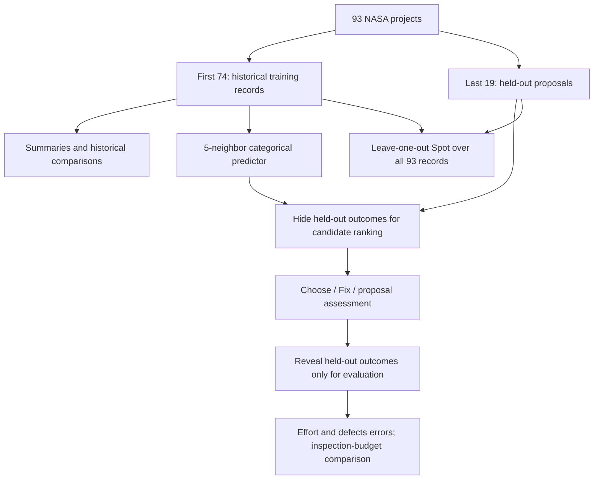
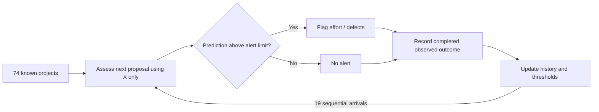
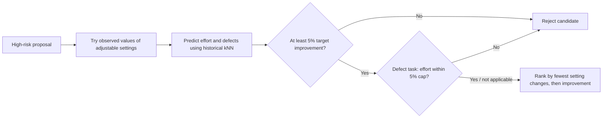
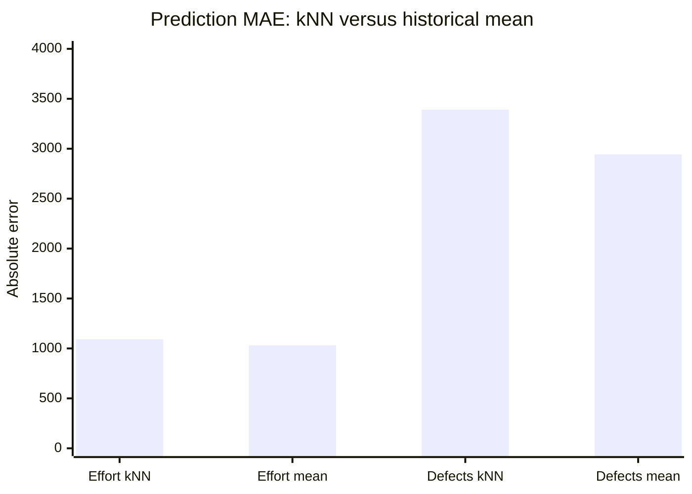
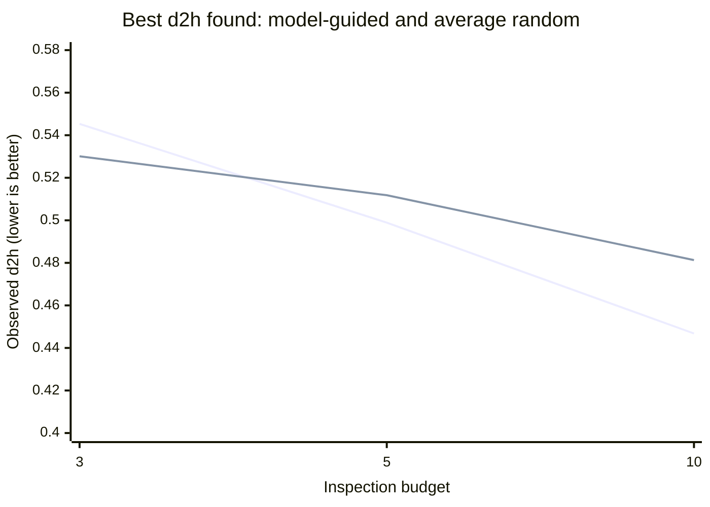
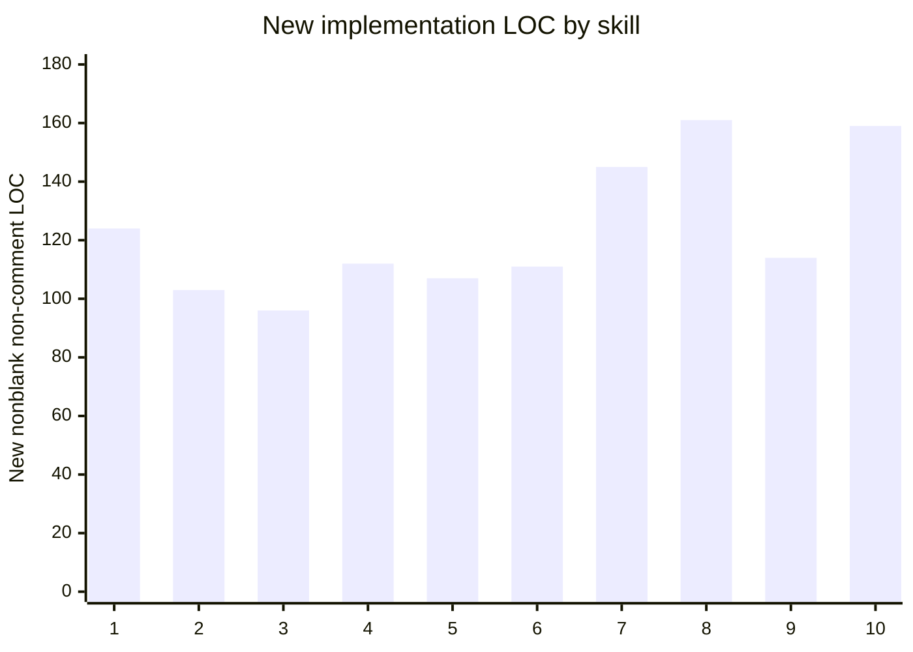
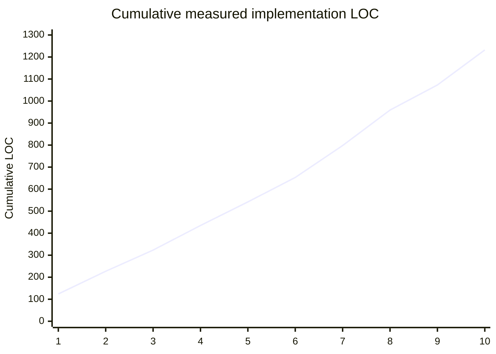

# NASA Software Project Estimation — Experimental Results


**Project:** The Shrinking-Code Experiment  

**Course:** CSC 591 — AI & Software Engineering  

**Dataset:** `data/raw/nasa93dem.csv`  

**Implementation:** `human_t7/nasa/` on branch `human-t7-nasa`  

**Frozen specification:** [`docs/requirements_nasa.md`](../../docs/requirements_nasa.md) (November 6, 2026)  

**Implementation checkpoint:** `t7-nasa-step10` (`ddb3e0b`)  

**Evidence status:** Ten program entry points executed successfully; targeted basic checks were run for individual skills. This is not a formal independent acceptance test of all 20 requirements.


## Executive summary


The NASA prototype implements ten successive capabilities spanning **20 frozen customer requirements**. It works with 93 historical software projects and uses 22 categorical input features to support description, prediction, statistical comparisons, sequential assessment, diagnosis, explanations, project selection, hypothetical repairs, anomaly detection, and baseline comparisons.


**Principal observations:**


1. **Prediction is not consistently superior to a simple baseline.** On the 19 held-out projects, five-neighbor kNN had higher mean absolute error (MAE) than a historical-mean baseline for both effort and defects.

2. **Budget-limited selection shows mixed results.** Model guidance did not beat average random selection at budget 3, but did at budgets 5 and 10. Many random trials nevertheless matched or beat the model.

3. **Potential repairs are predictions, not interventions.** Changing the schedule setting (`sced`) from `n` to `l` produced large modeled improvements for two selected proposals. This does not establish a causal benefit or the feasibility of such changes.

4. **Anomaly detection flags notable records.** Row 90 had an effort residual of +6,210.78; row 59 had a defects residual of +49,166. These are signals for review, not proof of data errors.

5. **New implementation LOC did not steadily shrink.** The ten measured additions totaled **1,232 nonblank, non-comment lines**; later steps were often larger. Complexity differs across skills, so this descriptive trend does not isolate the effect of reuse.


### Results at a glance


| Metric | Recorded result |

|---|---:|

| Historical projects | 93 |

| Categorical input features | 22 |

| Training / held-out split | 74 / 19 (first 74 / last 19) |

| Frozen requirements represented | 20 (2 per skill) |

| Skill entry points executing successfully | 10 / 10 |

| New implementation LOC | 1,232 |

| Mean new LOC per skill | 123.2 |

| kNN neighbors | 5 |

| Random selection trials | 30; seed 42 |


## Experimental flow





**Scoring convention:** The dataset declares `Kloc+` (maximize), `Effort-` (minimize), and `Defects-` (minimize). The distance-to-heaven score (**d2h**) is the root mean squared normalized distance to those three goal ideals: **lower is better**. In selection experiments, normalization bounds are computed from the 74 training records. The `Kloc+` maximizing direction is taken from the frozen specification and is not an independent judgment that increasing project size is inherently desirable.


---


## 1. Remember — Historical representation (NASA-01/02)


**Question:** What do the historical projects look like, and which achieved favorable combinations of size, effort, and defects?


- Loaded **93** records.

- Recorded ranges: `Kloc+`: **0.9–980**; `Effort-`: **8.4–8,211**; `Defects-`: **28–50,961**.

- Five best-ranked rows under the **full-dataset** d2h calculation: **60, 67, 46, 44, 77** (in that order).

- The ranking combines all three goal directions. A favorable combined score need not mean a project is best on every individual goal.


| Goal | Direction | Observed minimum | Observed maximum |

|---|---|---:|---:|

| `Kloc+` | Maximize | 0.9 | 980 |

| `Effort-` | Minimize | 8.4 | 8,211 |

| `Defects-` | Minimize | 28 | 50,961 |


**Finding:** Project outcomes span very large ranges. The best examples depend on tradeoffs among all three normalized goals rather than effort or defects alone. Full summary medians/means and the worst-five list were not retained in the verified conversation output and are **not invented here**; reproduce with `python3 human_t7/nasa/remember.py`.


## 2. Guess — Project prediction (NASA-03/04)


**Question:** Can the 22 known categorical characteristics estimate effort and defect risk for an unseen proposal?


**Method:** Five-nearest-neighbor categorical mismatch distance; predicted outcome is the mean of neighbors' outcomes. The returned neighbor minimum/maximum serves as an observed-neighbor range, **not a calibrated statistical prediction interval**.


- Training projects: **74**; held-out projects: **19**.

- Example proposal row **75**: predicted effort **268.8**, predicted defects **3,533.4**.

- Five example neighbors: **70, 74, 71, 72, 73**.


The definitive quantitative performance comparison appears in [Section 10 — Race](#10-race--baseline-comparisons-nasa-1920), which reuses the same predictions and evaluation split.


**Finding:** The model can generate traceable estimates and neighbor-based explanations. Whether those predictions are useful must be judged against baselines, not by their apparent precision.


## 3. Certify — Group comparisons (NASA-05/06)


**Question:** Do historically observed programmer capability or complexity groups show distinguishable outcomes?


The implementation compares **group means** using a two-sided permutation test with **9,999 permutations** and a fixed random seed; it does **not** implement the course's separate `same` procedure.


| Requirement | Groups compared | Outcome | Group sizes | Observed permutation p-value |

|---|---|---|---|---:|

| NASA-05 | `pcap=h` versus `pcap=vh` | Effort | 39 versus 10 | ≈ 0.6879 |

| NASA-06 | `cplx=n` versus `cplx=vh` | Defects | 10 versus 17 | ≈ 0.8801 |


**Finding:** Both observed p-values are large. For these selected contrasts, there is **insufficient evidence to reject the equal-mean null** at a conventional 0.05 threshold. This is not proof that the groups are equivalent or that capability/complexity has no effect; sample sizes are limited, and the test is not causal.


## 4. Flow — Sequential proposal assessment (NASA-07/08)


**Question:** Can the system assess arriving projects using information currently available, then incorporate completed records?


The experiment starts with **74** historical records and sequentially processes **19** arrivals. Predictions use the known X characteristics before observed outcomes are added to the historical set. Alerts compare predicted effort and defects with the current historical 75th-percentile thresholds.


| Flow result | Recorded value |

|---|---:|

| Initial historical records | 74 |

| Arrivals assessed | 19 |

| Final historical records | 93 |

| High predicted-effort alerts | 8 |

| High predicted-defect alerts | 4 |





**Finding:** The data stream was processed without reducing the final inventory. Alert counts are descriptive and do not measure precision, recall, or operational benefit; those evaluations would require additional work.


## 5. Blame — Attribute associations (NASA-09/10)


**Question:** Which categorical characteristics differentiate high-outcome and low-outcome projects?


For each target, the analysis compares the **23 lowest** and **23 highest** outcome projects and ranks features by **total variation distance (TV)** between categorical value distributions. A higher TV denotes stronger separation of the two observed groups.


| Target | Most separating characteristics | Recorded TV |

|---|---|---:|

| Effort | `acap` | ≈ 0.5652 |

| Effort | `plex` | ≈ 0.5652 |

| Effort | `time` | ≈ 0.5652 |

| Defects | `acap` | ≈ 0.6087 |

| Defects | `apex` | ≈ 0.5652 |

| Defects | `data` | ≈ 0.5217 |


**Finding:** `acap` strongly separates high- and low-outcome groups for **both** effort and defects. These statistics measure association and group separation; **they cannot identify causes** or justify changing personnel attributes as an intervention.


## 6. Justify — Explanation and tradeoffs (NASA-11/12)


**Question:** Can the system show why it issued a prediction and compare two proposals?


- For proposal **75**, the predicted effort was **268.8**, with five historical-neighbor examples supporting the estimate.

- Comparison of proposals **81** and **88** produced:


| Predicted outcome | Row 81 | Row 88 | Lower predicted risk |

|---|---:|---:|---|

| Effort | 201.60 | 1,091.44 | Row 81 |

| Defects | 1,424.00 | 11,579.40 | Row 81 |


The records differed on **10** categorical input attributes.


**Finding:** Row 81 is preferable on both modeled risk outcomes for this comparison, so this pair does not exhibit an effort-versus-defects conflict. Explanations describe model evidence and feature differences, not causal attribution of the predicted contrast.


## 7. Choose — Limited-budget project inspection (NASA-13/14)


**Question:** Which project settings look favorable historically, and which unseen proposals should be evaluated first with limited resources?


Using only the **74 training records**, the five most favorable historical examples were:


| Training-history rank | Project row | Historical d2h |

|---|---:|---:|

| 1 | 67 | 0.3938 |

| 2 | 60 | 0.3943 |

| 3 | 44 | 0.4386 |

| 4 | 68 | 0.4523 |

| 5 | 43 | 0.4598 |


For the 19 held-out candidates, selection ranks proposals using **X-only predictions of all three goals** and then reveals observed outcomes for the inspected subset.


| Inspection budget | Best inspected project row | Best observed d2h |

|---|---:|---:|

| 3 | 79 | 0.5453 |

| 5 | 76 | 0.4989 |

| 10 | 77 | 0.4468 |


**Finding:** More inspections improved the best result observed by this fixed ordering. In this implementation, the ranking is generated once before inspection; it is **not an adaptive active-learning policy**. Comparison with random inspection is in Section 10.


## 8. Fix — Hypothetical changes (NASA-15/16)


**Question:** Can changes in explicitly designated adjustable settings improve predicted effort or defects?


The explored settings were `docu`, `tool`, `site`, and `sced`, with only previously observed values proposed. The search tested changes to one or two settings, prioritized fewer changes, and required a **5%** target improvement. For NASA-16, it also capped the allowable predicted effort increase at **5%**.


| Metric | NASA-15: reduce effort | NASA-16: reduce defects |

|---|---:|---:|

| Proposal row | 79 | 88 |

| Hypothetical setting change | `sced: n → l` | `sced: n → l` |

| Alternatives tested | 3 | 3 |

| Original predicted effort | 1,208.00 | 1,091.44 |

| New predicted effort | 780.64 | 429.04 |

| Original predicted defects | 6,064.00 | 11,579.40 |

| New predicted defects | 3,625.40 | 2,986.80 |

| Improvement in target prediction | **35.4%** | **74.2%** |

| Change in other outcome | Defects **−40.2%** | Effort **−60.7%** |





**Finding:** Both best reported alternatives changed only `sced`. The numerical gains reflect the predictor's response to a hypothetical configuration. **No causal, operational, or feasibility conclusion follows.** Only three candidates were evaluated in each showcased case; that limited search space constrains the strength of the recommendation. Observed individual values need not imply a historically realistic combination.


## 9. Spot — Unusual project records (NASA-17/18)


**Question:** Which records are unusual in their characteristics, and which have outcomes that disagree with analogous records?


**NASA-17: Input anomalies.** For each project, average categorical distance to its five nearest **other** records provides an isolation score; larger is more unusual.


| Input anomaly rank | Project row | Isolation score | Nearest comparison rows |

|---|---:|---:|---|

| 1 | 56 | 0.3182 | 27, 28, 29, 30, 31 |

| 2 | 89 | 0.3182 | 83, 84, 59, 9, 13 |

| 3 | 57 | 0.2818 | 41, 47, 1, 2, 3 |

| 4 | 59 | 0.2727 | 11, 15, 19, 70, 71 |

| 5 | 83 | 0.2636 | 84, 89, 9, 17, 56 |


**NASA-18: Unexpected outcomes.** The predictor excludes the current record when estimating it (**leave-one-out**) and ranks absolute residuals: `residual = actual − predicted`.


| Effort anomaly row | Actual effort | Predicted effort | Signed residual |

|---|---:|---:|---:|

| 90 | 8,211.00 | 2,000.22 | **+6,210.78** |

| 59 | 4,560.00 | 124.80 | +4,435.20 |

| 82 | 480.00 | 3,546.42 | −3,066.42 |

| 42 | 2,400.00 | 65.52 | +2,334.48 |

| 46 | 2,400.00 | 232.80 | +2,167.20 |


| Defects anomaly row | Actual defects | Predicted defects | Signed residual |

|---|---:|---:|---:|

| 59 | 50,961 | 1,795 | **+49,166** |

| 46 | 18,447 | 2,490.40 | +15,956.60 |

| 77 | 17,597 | 5,848 | +11,749 |

| 54 | 11,761 | 1,232.20 | +10,528.80 |

| 89 | 406 | 10,834 | −10,428 |


**Finding:** Row 59 is unusual both in its input profile (fourth highest isolation) and defects residual (highest). That makes it a candidate for follow-up review, **not** automatic correction or deletion. Large residuals may also mean model misspecification or genuinely unusual projects.


## 10. Race — Baseline comparisons (NASA-19/20)


### NASA-19: kNN versus the historical-mean predictor


The first 74 records are used for training; the last 19 are held out. Both methods use the same test projects and MAE metric (**lower is better**).


| Target | kNN MAE | Historical-mean MAE | Lower-error method | Held-out projects with lower kNN error |

|---|---:|---:|---|---:|

| Effort | 1,092.17 | **1,031.84** | Historical mean | 4 / 19 |

| Defects | 3,391.13 | **2,943.87** | Historical mean | 11 / 19 |





**Finding:** The mean baseline has lower aggregate MAE for **both** targets. kNN wins on a majority of individual defect cases (11/19) but loses on mean defects MAE, consistent with some relatively large errors driving the total. No statistical significance claim has been established.


### NASA-20: model-guided versus random inspection


Thirty random permutations of the same 19 candidates were generated with random seed **42**, using inspection budgets **3, 5, 10**. All strategies reveal observed goals only when evaluating inspected candidates. Scores are the **lowest observed d2h** encountered within each budget.


| Budget | Model d2h | Mean random d2h | Best random d2h | Random trials matching/beating model |

|---|---:|---:|---:|---:|

| 3 | 0.5453 | **0.5301** | 0.4468 | 16 / 30 |

| 5 | **0.4989** | 0.5118 | 0.4468 | 14 / 30 |

| 10 | **0.4468** | 0.4813 | 0.4468 | 11 / 30 |





**Line order in the chart: model-guided first; random-trial mean second. The table supplies the precise labels and values.**


**Finding:** Model guidance is **worse than the average random trial at budget 3**, but **better at budgets 5 and 10**. However, 16/30, 14/30 and 11/30 random trials respectively **matched or beat** it. The best random trial matched the best found score of 0.4468 at every budget. These exploratory results do **not** show systematic dominance or establish statistical significance.


---


## 11. The shrinking-code question: did additions become smaller?


The project recorded nonblank, non-comment implementation LOC at each Git tag. Because each step introduced a separate file, the values below are the size of the **new skill module**, not a complete analysis of edits to earlier modules. Docstring lines and other non-comment source text remain counted under the used rule.


| Step | Skill | New LOC | Cumulative LOC |

|---:|---|---:|---:|

| 1 | Remember | 124 | 124 |

| 2 | Guess | 103 | 227 |

| 3 | Certify | 96 | 323 |

| 4 | Flow | 112 | 435 |

| 5 | Blame | 107 | 542 |

| 6 | Justify | 111 | 653 |

| 7 | Choose | 145 | 798 |

| 8 | Fix | 161 | 959 |

| 9 | Spot | 114 | 1,073 |

| 10 | Race | 159 | **1,232** |








**Descriptive observations:**


- Total added LOC: **1,232**; arithmetic average **123.2** lines per skill.

- Smallest module: **Certify, 96 LOC** (step 3).

- Largest module: **Fix, 161 LOC** (step 8).

- First five modules total **542 LOC** (average **108.4**), while the last five total **690 LOC** (average **138.0**).

- Code was reused through imports (e.g., Guess in later skills, Choose in Race), but there is **no consistent decrease in new LOC** over this sequence.


**Interpretation:** The observed additions **do not demonstrate a monotonic shrinking-code effect**. This does **not** imply reuse is ineffective: later requirements (repair search, trial comparisons, reporting) can have different intrinsic complexity. There is no matched no-reuse comparison within this single branch. Treatment-level claims require a common counting convention and controlled comparisons across trials.


## 12. Verification and limitations


### Recorded execution smoke test


The user executed each program entry point on the final implementation branch; all returned successful process exit codes:


| Program | Smoke-test result |

|---|---|

| `remember.py` | PASS |

| `guess.py` | PASS |

| `certify.py` | PASS |

| `flow.py` | PASS |

| `blame.py` | PASS |

| `justify.py` | PASS |

| `choose.py` | PASS |

| `fix.py` | PASS |

| `spot.py` | PASS |

| `race.py` | PASS |


Targeted checks reported during development also covered, among other things, masked outcomes for held-out selection, leave-one-out exclusion, repair restrictions, residual calculations, deterministic random rankings, and budget consistency. **Smoke tests and basic assertions are not full customer acceptance tests.** Detailed test commands, environment and repository reproduction steps belong in `EXPERIMENT.md`.


### Threats to validity


1. **Small sample and fixed split.** Only 93 records, with 19 held out as the final block rather than drawn from multiple randomized splits. Performance may depend on ordering and sample composition.

2. **Categorical-only distance.** All 22 X attributes contribute equally to simple mismatch distance; relationships, importance and potential numeric information are not modeled beyond this approach.

3. **Rare categories and limited repair alternatives.** Some hypothetical settings have little empirical support and may not represent feasible interventions.

4. **Association is not causation.** Feature-separation scores, neighbor explanations and proposed repairs cannot establish what caused an outcome.

5. **Random comparison uncertainty.** Thirty seeded random permutations are reproducible but constitute a limited descriptive experiment, not a formal significance analysis.

6. **Normalization choices.** d2h depends on the declared goal directions and training-derived min/max bounds. In particular, the convention treats larger `Kloc+` as favorable.

7. **Code-growth comparability.** Module LOC includes distinct skill complexity and excludes changes to earlier files; documentation and test LOC were not included in the reported 1,232.


## 13. Conclusions and next research steps


**What this trial establishes:** A ten-skill NASA decision-support prototype executes end to end, produces interpretable outputs for all ten skills, and exposes both successes and failures against simple baselines. The recorded implementation adds **1,232 LOC** without a consistently shrinking per-step pattern.


**What it does not establish:** Better-than-baseline prediction, statistically superior inspection policies, causally effective repairs, full correctness against all 20 customer requirements, or superiority over other implementation treatments.


For a defensible cross-treatment research conclusion, standardize the LOC-counting definition, run equivalent acceptance tests across treatments and datasets, and compare repeated matched trials rather than relying on a single branch.


---


### How to reproduce the outputs


From the repository root:


```bash

for skill in remember guess certify flow blame justify choose fix spot race; do

  echo "===== $skill ====="

  python3 "human_t7/nasa/$skill.py"

done

```


The per-step implementation states are preserved as Git tags `t7-nasa-step1` through `t7-nasa-step10`, ending at commit `ddb3e0b`. For exact counting details, execution environment, and acceptance-test evidence, consult the planned companion file `human_t7/nasa/EXPERIMENT.md` once created.
